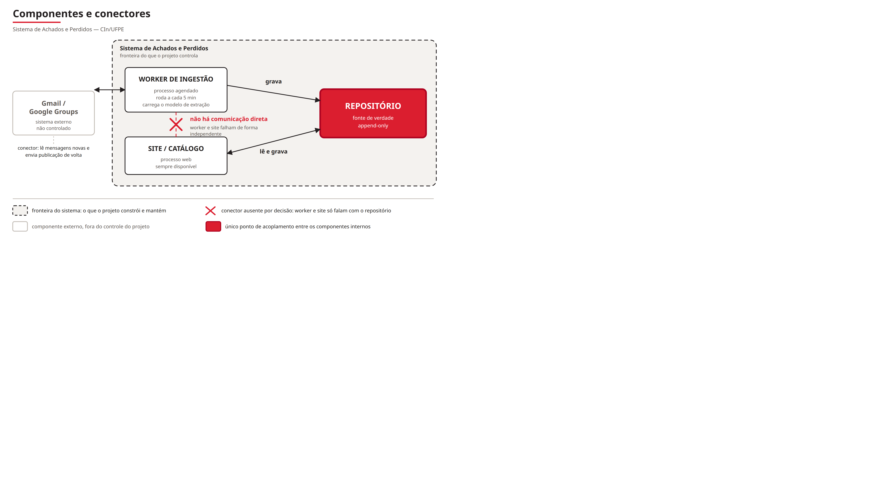
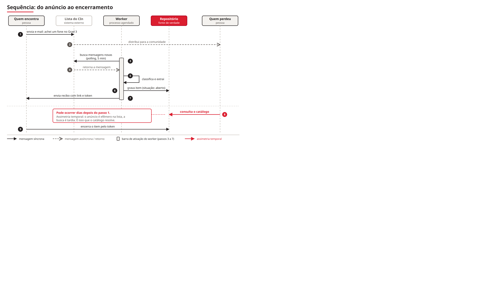
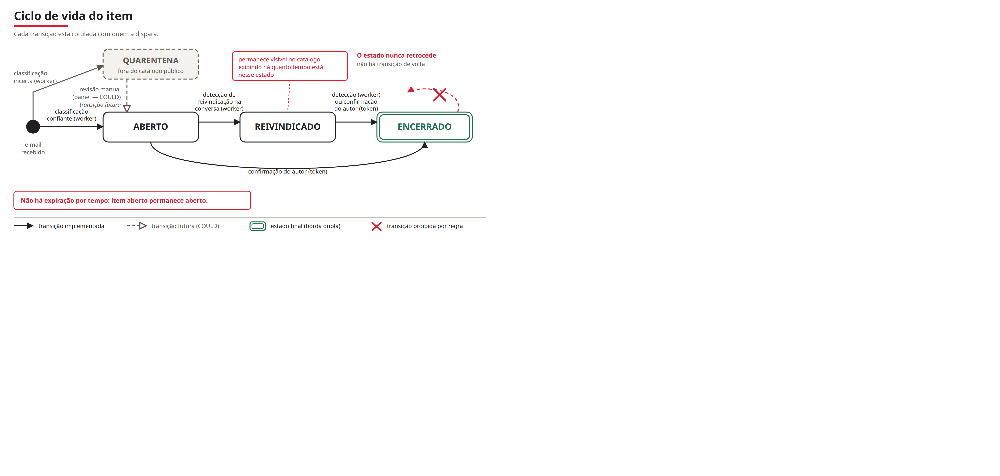
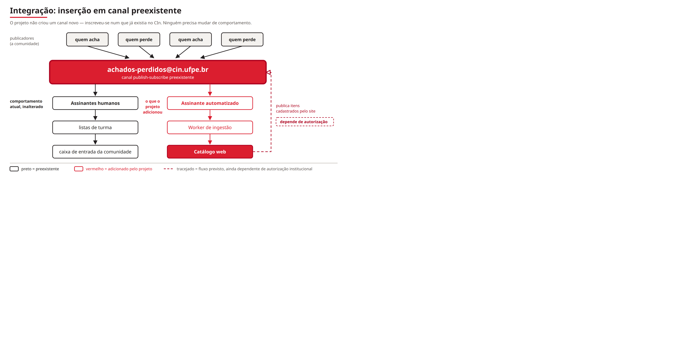

# Arquitetura do Sistema de Achados e Perdidos

**Centro de Informática — UFPE**
Disciplina: Integração e Evolução de Sistemas de Informação (CIN0139) · 2026.2
Versão: 02/10/2026 · revisado em 13/10/2026 (ADR-010, login com a conta do CIn)

---

## Sumário

1. [Proposta de arquitetura](#1-proposta-de-arquitetura)
2. [Sistemas, dados, integrações e tecnologias](#2-sistemas-dados-integrações-e-tecnologias)
3. [Justificativa da arquitetura escolhida](#3-justificativa-da-arquitetura-escolhida)
4. [Rastreabilidade: da observação de campo à decisão](#4-rastreabilidade-da-observação-de-campo-à-decisão)

Documentos relacionados: `ADR.md` (os nove registros de decisão em formato MADR, com
alternativas e consequências detalhadas), `BACKLOG.md` (catorze histórias em Gherkin) e
`diagramas/` (as quatro visões em SVG e PNG).

---

# 1 · Proposta de arquitetura

## 1.1 O problema que a arquitetura resolve

O Centro de Informática não possui serviço de achados e perdidos. Não há custódia
institucional: nem a portaria nem a Gerência de Infraestrutura recebem ou guardam objetos
achados — ambas confirmaram isso por telefone em 18/09/2026.

O que existe é um **processo comunitário que funciona**. A cultura estabelecida é deixar o
objeto onde foi encontrado e avisar a lista `achados-perdidos@cin.ufpe.br`; o dono vai buscar.
A Gerência de Infraestrutura avalia o índice de satisfação como alto.

**O projeto não conserta um processo quebrado. Ele preenche lacunas de um processo eficaz.**
Três lacunas foram nomeadas em campo:

| Lacuna | Natureza |
|---|---|
| Objetos caem em lugares onde não faz sentido deixá-los, e ninguém os recebe | custódia |
| Não há aviso de que o item foi recuperado — o desfecho não fica registrado | observabilidade |
| Escrever um e-mail é atrito; notificar deveria custar poucos cliques | usabilidade |

Há ainda uma quarta característica do canal atual, que é de informação e não de processo: **o
e-mail passa e some**. Quem perde algo hoje precisa vasculhar a caixa de entrada de semanas
atrás, e quem chega depois do anúncio não tem como encontrá-lo. Um catálogo permanente e
pesquisável é a resposta a isso.

## 1.2 A restrição que governa todas as decisões

O risco mais severo do projeto não é técnico. Está registrado como **R6: não há dono do
processo, e não haverá depois de dezembro.**

O Product Owner declarou a ordem de preferência para a continuidade: **(A) ninguém mantém, o
sistema roda até quebrar** > (D) próxima turma de IESI ou projeto de extensão > (C)
transferir para a Gerência de Infraestrutura. O sistema é tratado como **artefato acadêmico,
não ferramenta institucional**: continuidade é bônus, não objetivo, e não há data de
desligamento prevista.

A posição é defensável porque o escopo da disciplina é modelagem, não operação de software em
produção — e porque prometer uma continuidade que não se pode garantir é pior que não
prometer. Mas ela impõe uma exigência à arquitetura: **o sistema precisa sobreviver ao
abandono.**

Daí deriva o encadeamento que organiza o documento inteiro:

```
   Não há dono (R6)
        ↓
   O sistema precisa sobreviver ao abandono
        ↓
   Sobreviver ao abandono exige que as partes falhem independentemente
        ↓
   Falhar independentemente exige desacoplamento
        ↓
   O desacoplamento mais simples disponível é o repositório compartilhado
```

Nenhum passo é opcional. Retirado o R6, a cadeia inteira se desfaz — e seria legítimo propor
uma arquitetura diferente.

## 1.3 Estilo arquitetural

**Orientado a dados compartilhados** (*shared-data* / *repository style*), com
**pipes-and-filters** descrevendo o interior do worker.

O repositório central é o elemento arquitetural principal. Worker e site **não se conhecem**:
conhecem apenas o repositório. A ausência desse conector é tão arquitetural quanto a presença
dos outros dois.



Três consequências diretas:

- **Falha no worker não derruba o site.** O catálogo continua servindo consultas; apenas
  deixa de receber itens novos. É o que garante que haja algo demonstrável mesmo com o
  pipeline quebrado.
- **Cada processo é desenvolvido, testado e implantado separadamente**, o que importa com sete
  pessoas em dois subgrupos.
- **O worker carrega o modelo de extração (~200 MB); o site não.** Não há motivo para o
  processo que serve páginas carregar isso.

Internamente, o worker é um pipeline — **ler → classificar → extrair → gravar** — em que cada
estágio transforma e passa adiante. A quarentena é o filtro que interrompe o pipe.

Foi considerado descrever a arquitetura como "camadas + *batch job*". É honesto, mas subestima
o desacoplamento e não captura a independência do worker, que é a propriedade que responde ao
R6.

## 1.4 Visão de execução



O caso real que dimensiona o sistema: um fone foi anunciado às 16h39 e reivindicado às 16h42.
Três minutos. É por isso que o worker acorda a cada cinco minutos e não de hora em hora — com
intervalo longo, o catálogo vira registro histórico em vez de ferramenta de busca.

A linha pontilhada do diagrama marca a assimetria temporal que justifica o sistema: quem
procura chega **depois** do anúncio, e é esse intervalo que hoje não tem resposta.

---

# 2 · Sistemas, dados, integrações e tecnologias

## 2.1 Sistemas envolvidos

A fronteira entre o que o projeto constrói e o que ele apenas consome é explícita, porque dela
dependem as decisões de evolução.

### Dentro da fronteira — construídos e mantidos pelo projeto

| Sistema | Natureza | Responsabilidade |
|---|---|---|
| **Worker de ingestão** | Processo agendado, roda e termina | Ler mensagens novas, classificar, extrair dados, gravar, enviar o aviso de publicação ao autor |
| **Site / catálogo** | Aplicação web, fica de pé | Buscar e exibir itens, aceitar cadastro e a gestão do item pelo autor logado com a conta do CIn |
| **Repositório** | Banco de dados relacional | Fonte de verdade, append-only, único ponto de integração entre os dois |

O nome **"worker de ingestão"** é deliberado — não "agente". É um ETL agendado, sem autonomia
decisória: não escolhe o que fazer, executa um pipeline fixo.

### Fora da fronteira — sistemas de terceiros

| Sistema | Papel | Controle do projeto |
|---|---|---|
| **Gmail / Google Groups** (`achados-perdidos@cin.ufpe.br`) | Canal de mensagens preexistente da comunidade | Nenhum. É Google Workspace institucional, administrado pela Gerência de Infraestrutura |
| **Login Google** (OAuth, só contas `@cin.ufpe.br`) | Identidade de quem anunciou, para gerir o próprio item (ADR-010) | Configuração do app OAuth apenas. Contas, senhas e recuperação são do Google Workspace do CIn |
| **Serviço de hospedagem** | Execução do worker e do site | Configuração apenas |

A lista institucional **não foi criada pelo projeto**. Ela já existia, com assinantes humanos
alcançados por listas de turma. Essa distinção é o centro da seção 2.3.

### Atores humanos

- **Quem acha um objeto** — anuncia por e-mail (como hoje) ou pelo site (novo)
- **Quem perdeu um objeto** — busca no catálogo, ou recebe o e-mail como sempre recebeu
- **Quem aparece num item sem tê-lo publicado** — pode pedir remoção (ex.: documento com nome
  de terceiro)
- **Não existe o ator "administrador".** A ausência é decisão de arquitetura, não omissão de
  levantamento.

## 2.2 Dados

### Entidades

| Entidade | Conteúdo | Regra |
|---|---|---|
| `mensagem_bruta` | Corpo integral do e-mail, remetente, data, `thread_id` | **Append-only.** Gravada antes de qualquer extração |
| `item` | O objeto anunciado: descrição, local, data, situação, localização | Uma linha por thread |
| `evento` | Cada transição de estado, com a fonte que a produziu | Append-only. Nunca sobrescreve |
| `quarentena` | Mensagens retidas por baixa confiança, com o motivo | Não vira item até revisão |
| `processamento` | Controle de "já processei esta mensagem" | Vive no banco, não na caixa de e-mail |

**A unidade de registro é a thread, não a mensagem.** Um e-mail e todas as suas respostas
formam um registro só, agrupado pelo `threadId` do Gmail. Isso resolve de graça os casos de
encaminhamento, reenvio e resposta de confirmação. A alternativa — "um objeto = um registro" —
exigiria decidir identidade de objeto: automaticamente erra e funde itens de pessoas
diferentes; manualmente exige um operador que não existe.

Guardar o corpo bruto sempre custa alguns KB por item e paga três coisas: permite reprocessar
sem reler o Gmail, viabiliza exibir o texto original no item, e constitui o conjunto de teste
do parser.

### Os dois eixos de estado

Localização e situação são eixos independentes, e tratá-los como um só produziria um catálogo
que mente.



**`situação`** — atualizada automaticamente pelo worker:

```
aberto  →  reivindicado  →  encerrado
```

**`localização`** — declarada no cadastro, alterada **somente** por declaração explícita:
`no local` · `com quem achou` · `com um setor` (+ nome do setor) · `caixa do bloco A/E` ·
`devolvido`

`com um setor` foi incluído pelo PO em 14/10/2026. O corpus mostra que a SecGrad (E124), a
Gerinfra (B021) e outros setores guardam justamente os objetos de maior valor, como celular,
documento e chave. O nome do setor é texto, com sugestões, e não uma lista fechada que
alguém precisaria manter (R6).

**`local`** é onde o objeto foi achado ou perdido, e não onde está agora. É uma **lista**,
porque 6% dos anúncios citam mais de um lugar ("Grad 5 ou lab de hardware"), e o filtro por
qualquer um deles encontra o item. Ele segue a mesma regra da localização: só uma mensagem
do **autor** da thread corrige o local. A correção de terceiro vira evento e não muda o campo.
Decisões do PO em 14/10/2026.

A assimetria é deliberada. O worker **infere situação** porque o vocabulário do corpus é
pequeno e repetitivo ("Encontraram", "Já peguei", "é meu", "Achei já, obrigado"). O worker
**não infere localização** porque mudança de lugar quase nunca é anunciada — e um palpite
errado manda alguém a um lugar onde o objeto não está.

Três regras invioláveis:

1. **Status nunca retrocede nem pula etapa.** Detectada uma reivindicação em item já
   encerrado, o evento é registrado e o status não muda. **Exceção única:** uma declaração de
   desfecho leva de `aberto` direto a `encerrado`. Se vem do autor, pelo site (US-15) ou na
   thread (US-10, "Achei já, obrigado"), a fonte é "confirmação do autor". Se vem de
   terceiro na thread ("resolvido, ela achou"), a fonte é "terceiro", com confiança média, e o
   catálogo exibe "encerrado segundo terceiro".
   Exigir `reivindicado` antes registraria uma etapa que não aconteceu. Num **perdido**,
   `reivindicado` é alguém dizer que o objeto está com ele ("está aqui na SecGrad"). Uma
   reivindicação fraca ("acredito que pode ser minha") também conta. Decisões do PO em
   14/10/2026.
2. **`reivindicado` ≠ `encerrado`.** Entre dizer "é meu" e retirar o objeto passa tempo, e
   esse intervalo é informação útil: o catálogo mostra *há quanto tempo* o item está
   reivindicado sem confirmação. "Há 2 horas" e "há 3 semanas" significam coisas diferentes.
3. **Não há expiração por tempo.** Não existe política de guarda no CIn, e inventar um prazo é
   decidir no lugar da instituição.

### Dados pessoais

O catálogo expõe as mesmas pessoas que o e-mail já expunha, mas muda **permanência, busca e
agregação**. Num catálogo é possível ver que a mesma pessoa perdeu seis coisas no semestre —
inferência que o e-mail isolado não permitia. Além disso, a lista é fechada à comunidade do
CIn e o catálogo é aberto na web. Quatro medidas, em ordem de importância:

1. **Preventiva: o endereço de quem anunciou não é publicado.** O catálogo mostra item, local
   e data, com um botão de contato que encaminha a mensagem sem revelar o endereço. O campo
   não existe em nenhuma resposta da API.
2. **O texto original fica dentro do CIn.** Quem não entrou vê só os campos extraídos. O texto
   original sai da API apenas para sessão `@cin.ufpe.br`, e sempre com telefones e e-mails
   mascarados por regra determinística no servidor. A busca de quem não entrou não consulta o
   texto original, para que um termo buscado não revele o conteúdo. Decisão do PO em
   14/10/2026.
3. **Autosserviço:** quem publicou remove o próprio item entrando com a conta do CIn (ADR-010).
4. **Pedido humano:** canal de contato para quem aparece num item sem tê-lo publicado — o caso
   do documento com nome de terceiro, que não é autor do item e por isso não pode removê-lo nem logado. Sem
   automação: alguém do grupo remove à mão, são poucos casos.

Remoção é **ocultar do catálogo, não apagar a linha**. O registro permanece para auditoria.

## 2.3 Integrações

### Com o Gmail: mecanismo de RPC sobre modelo de mensageria

Dos quatro estilos clássicos de integração entre aplicações, banco de dados compartilhado é
impossível (não há acesso à base do Google) e transferência de arquivos não se aplica. A
classificação correta é composta:

- **O mecanismo é invocação remota** — o worker chama a API REST do Gmail
- **O modelo é troca de mensagens** — o e-mail é assíncrono, com fila e entrega desacoplada no
  tempo; o Gmail é o *broker*

O enquadramento que dá força ao argumento:

```
achados-perdidos@cin.ufpe.br   ←  canal publish-subscribe preexistente
         │
         ├── assinantes humanos (a comunidade, via listas de turma)
         └── assinante automatizado (o worker)   ← o que o projeto adicionou
```

**O grupo não criou um canal novo: inscreveu-se num canal que já existia.** É a formulação
arquitetural do princípio de produto defendido desde a Entrega 2 — ninguém precisa mudar de
comportamento para o sistema funcionar.



### Padrões de integração aplicados

Cada padrão abaixo (Hohpe & Woolf, *Enterprise Integration Patterns*, 2003) nomeia uma decisão
que o grupo tomou por conta própria antes de saber que tinha nome:

| Padrão | A decisão que ele descreve |
|---|---|
| *Polling Consumer* | O worker acorda a cada 5 min e busca; não recebe push |
| *Idempotent Receiver* | Reprocessar a mesma mensagem não duplica item |
| *Message Filter* | A quarentena descarta o que não pertence ao domínio |
| *Content Enricher* | A extração agrega estrutura à mensagem bruta |
| *Claim Check* | O corpo bruto fica guardado e referenciado, não relido do Gmail |

### Isolamento da dependência externa

Tanto a leitura quanto o envio ficam atrás de uma abstração com implementações trocáveis. O
resto do sistema não sabe de onde a mensagem veio nem para onde vai.

| Ponta | Implementações previstas |
|---|---|
| Leitura | Gmail do projeto, por encaminhamento (ADR-011) · arquivos locais · formulário do site |
| Envio | Gmail do projeto, só o aviso privado ao autor · não enviar · gravar em arquivo para inspeção |

Três justificativas que se somam: **(a)** o §3.5 do documento de discovery já previa isso em
setembro, antes de existir código, de modo que implementar é coerência de método; **(b)**
destrava o trabalho do backend imediatamente, sem credencial e sem internet, com um conjunto
de mensagens fixo e repetível; **(c)** é o argumento de evolução mais forte do projeto — a
troca de origem não toca nenhuma linha fora da implementação do Gmail. Isso foi posto à prova
em 22/10/2026, quando a conta institucional foi negada e a leitura passou para o Gmail do
projeto, por encaminhamento (ADR-011).

**Efeito colateral valioso:** o sistema inteiro roda sem Google nenhum, então a demonstração na
banca não depende de rede nem de credencial.

### Integração interna: API REST entre site e worker

Com linguagens distintas nos dois lados, o site não pode importar a camada de acesso a dados —
ela precisa ser exposta como interface de rede. As regras de visibilidade ficam **no lado
servidor**, não replicadas no cliente: itens em quarentena e itens removidos nunca aparecem em
nenhuma consulta, e o endereço de e-mail não é campo de resposta em endpoint algum. A exceção
única é `GET /eu/itens`, que devolve ao autor as mensagens dele que abriram uma thread e foram
retidas, para que ele as classifique (US-15).

## 2.4 Tecnologias

| Camada | Escolha | Motivo |
|---|---|---|
| **Worker** | Python | Ecossistema de NLP; é onde GLiNER vive |
| **Classificação** | Parser determinístico (regex + palavras-chave) | Auditável, testável, sem alucinação |
| **Extração** | NER via GLiNER | Reconhece entidades sem treinar modelo próprio |
| **Site** | JavaScript | Competência já existente no subgrupo de front |
| **Banco** | PostgreSQL | Busca textual em português sem desenvolvimento adicional; sem contenção de escrita entre dois processos |
| **Integração externa** | Gmail API + OAuth | `@cin.ufpe.br` é Google Workspace: o mesmo código serve para conta pessoal e institucional |
| **Configuração** | Variáveis de ambiente | Nenhuma credencial em código; migração de hospedagem sem alterar o programa |

### A decisão de não usar LLM

Classificação e extração são feitas por **parser determinístico e NER**, não por modelo de
linguagem. O sistema lê texto que chega de fora, de qualquer pessoa da comunidade — exatamente
a superfície onde injeção de prompt acontece. Usando parser e NER, **prompt injection e
alucinação deixam de ser possíveis por construção**, não por mitigação. A recomendação veio de
um engenheiro com pipeline equivalente em produção.

O custo assumido: o parser erra mais em frases incomuns. A quarentena absorve esse custo.

### A consequência não opcional da escolha de stack

Duas linguagens implicam que **a definição das estruturas de dados passa a existir em dois
lugares**, com possibilidade de divergência. Duas consequências práticas:

1. **O contrato da API precisa ser definido cedo** — é o item que trava os dois subgrupos ao
   mesmo tempo, e portanto o mais urgente do cronograma. A prática adotada é *contract-first*:
   o contrato é acordado e publicado antes da implementação, com um mock servindo respostas de
   exemplo, para que o front trabalhe contra o contrato e não contra o código de ninguém.
2. **As regras de visibilidade ficam centralizadas no servidor**, nunca replicadas no front.

### Estrutura do repositório

```
lostandfound/
├── worker/   ← script Python: acorda, lê, grava, morre
├── site/     ← aplicação web: fica de pé
├── shared/   ← modelos e schema, importados pelos dois
└── README.md
```

Um repositório porque são sete pessoas numa disciplina e o schema é compartilhado. Dois
processos porque a natureza difere e a falha de um não pode derrubar o outro.

### Hospedagem

Começar em serviço gerenciado gratuito; migrar para VM do CIn se o Centro adotar o sistema. A
migração é barata desde que se respeite configuração por variável de ambiente e um worker sem
dependência de recurso específico do provedor — um script que roda e termina roda igual em
cron de VM ou em agendador de nuvem.

Deliberadamente **não se pediu VM à Gerência de Infraestrutura**: a fila de pedidos já tem três
itens, e se for preciso priorizar, que seja a permissão de postar na lista. Em 22/10/2026 a
Gerinfra negou o pacote inteiro (ADR-011).

---

# 3 · Justificativa da arquitetura escolhida

## 3.1 O princípio que atravessa todas as decisões

> **O sistema informa, não arbitra. E não depende de ninguém olhando.**

Toda decisão abaixo é uma aplicação desse princípio a um caso concreto.

## 3.2 As decisões e suas alternativas descartadas

### Por que repositório compartilhado, e não chamada direta entre os componentes

**Alternativa descartada:** o site chama o worker para reprocessar, ou o worker notifica o site
quando há item novo.

**Motivo:** qualquer conector direto faz a falha de um derrubar o outro. Com o banco como
único ponto de integração, o site funciona com o worker parado. Como não haverá ninguém de
plantão para reiniciar processos, degradação parcial silenciosa é a única forma de falha
aceitável.

### Por que não há fila de mensagens

**Alternativa descartada:** uma fila (RabbitMQ, Redis, SQS) entre a ingestão e o
processamento.

**Motivo:** fila é a resposta certa para volume alto e múltiplos produtores. O volume real é
de aproximadamente **dez itens por mês**, com um produtor. Uma fila adicionaria um componente
que pode falhar sem resolver problema existente — e cada componente a mais é mais uma coisa
que pode quebrar depois que o grupo se dispersar.

**Rejeitar complexidade justificadamente é mais maduro que adotá-la.**

### Por que não há painel administrativo na primeira versão

**Alternativa descartada:** interface autenticada para revisar, corrigir e publicar itens.

**Motivo:** exigiria **um responsável diário que o projeto não tem**. Um painel sem alguém que o abra é uma tela que ninguém usa.

**A solução adotada:** quem publicou corrige e encerra o próprio item entrando com a conta
Google do CIn (ADR-010). Até 13/10/2026 o mecanismo era um link com token no recibo. Ele foi
substituído porque o login institucional não cria conta nem senha para o projeto manter e
elimina o risco de link encaminhado. **O mesmo acesso que edita também encerra**, o que transforma
correção em captura de desfecho: a pessoa vem corrigir um erro e, de graça, registra o
desfecho que hoje ninguém registra.

O painel de curadoria permanece no backlog como *could*. Se o processo for incorporado
institucionalmente, e portanto passar a existir um responsável, ele sobe de prioridade — o
esforço é baixo porque a quarentena já é a estrutura; o painel só adiciona interface sobre ela.

### Por que quarentena, e por que o critério é classificação e não extração

Três tipos de erro do pipeline, com custos muito diferentes:

| Erro | Custo | Tratamento |
|---|---|---|
| Extração incompleta (não pegou a cor) | **Baixo** — o texto original está visível e o leitor corrige mentalmente | Publica assim mesmo |
| Classificação errada (piada virou item) | **Médio** — visivelmente absurdo | Quarentena |
| Status errado (marcou encerrado o que não foi) | **Alto** — mente para quem procura | Status nunca retrocede; fonte declarada |

O portão tem duas perguntas, nesta ordem:

```
é achado e perdido?            ──não──→  QUARENTENA
         ↓ sim
sabe se é achado OU perdido?   ──não──→  QUARENTENA
         ↓ sim
                PUBLICA
```

A segunda pergunta existe por causa de casos reais do corpus como o assunto *"[PERDIDO]"* com
o corpo *"Mouse deixado no Grad02"*, que pode ser perda ou achado. Chutar a direção põe o item
na aba errada, e quem procura não encontra: **erro silencioso e caro**. Uma pergunta como
*"alguém viu um fone preto?"* não é ambígua: quem pergunta está procurando, e o item é
publicado como perdido (decisão do PO em 14/10/2026).

Quem anunciou pela lista e teve a mensagem retida vê essa mensagem em "Meus anúncios" e pode
dizer se é perda ou achado (US-15). O autor vira curador do próprio anúncio, e a quarentena
se esvazia sem criar o papel de curador que o R6 proíbe.

**Extração fraca não retém o item.** "Encontrei esse carregador no Grad 05" é anúncio legítimo,
apenas magro. **Campo vazio é honesto; campo errado não é.**

A quarentena tem ainda um efeito colateral útil: é o conjunto de teste do parser. Cada item
retido é um caso que o pipeline não resolveu, e revisar a fila mostra quais palavras-chave
faltam nas regras.

### Por que o anúncio feito no site sai da conta da própria pessoa

O site não posta na lista. Depois do cadastro, ele abre um e-mail pronto, e a pessoa o envia
da própria conta (ADR-011). As respostas chegam a ela porque foi ela quem enviou, sem
`Reply-To` e sem conta do sistema no meio. Para quem lê a lista, o anúncio é igual a qualquer
outro.

**Alternativas descartadas:**
- **Conta do sistema com `Reply-To` da pessoa** (ADR-007): dependia da conta e da permissão de
  postar, que a Gerinfra negou em 22/10/2026.
- **Centralizar as respostas no sistema:** mudaria o comportamento de quem nem é usuário do
  site. Quem só lê a lista passaria a responder para um robô, e a entrega física continuaria
  invisível de qualquer jeito.
- **Domain-wide delegation no Google Workspace:** custo político alto. O e-mail pronto chega ao
  mesmo resultado, a mensagem sair da conta da pessoa, sem delegação nenhuma.

## 3.3 Atributos de qualidade: o que a arquitetura otimiza e o que sacrifica

Uma arquitetura que não declara o que sacrificou não foi escolhida, foi herdada.

**Priorizados**

- **Manutenibilidade sem mantenedor** — todas as decisões convergem para isto
- **Tolerância a falhas parciais** — o site vive sem o worker; o sistema opera sem nenhuma
  permissão institucional
- **Modificabilidade da fonte de dados** — trocar Gmail por arquivos ou formulário é trocar uma
  implementação
- **Corretude sobre completude** — a quarentena prefere o catálogo menor ao catálogo errado

**Sacrificados conscientemente**

- **Desempenho e escalabilidade** — ~25 itens/mês (pico de ~55, quase zero nas férias,
  segundo o corpus) e população fixa; escalar é problema que não
  existe
- **Tempo real** — cinco minutos de latência é folga confortável
- **Segurança forte** — sem papéis nem contas próprias; o único login é o da conta do CIn, para
  o autor gerir o próprio item; o dado já é público por natureza, pois já circula numa lista
  aberta
- **Completude do catálogo** — itens duvidosos ficam de fora

## 3.4 O trade-off central

> **Num sistema sem curador, um item errado custa mais que um item ausente — porque ninguém vai
> corrigi-lo.**

Em um sistema com curador, publicar na dúvida é barato: alguém conserta depois. Sem curador, o
erro é permanente. **A assimetria de custo entre os dois tipos de erro é o que determina o
critério**, e é por isso que a escolha recai sobre um catálogo menor e confiável em vez de
completo e ruidoso.

## 3.5 Observabilidade, com escopo honesto

A Gerência de Infraestrutura e, de forma independente, a secretaria de graduação apontaram a
mesma lacuna: não há registro de quais itens voltam para os donos.

A formulação que o sistema assume:

> O sistema registra desfechos quando declarados — por confirmação do autor ou detecção na
> conversa. Não persegue completude: desfechos fora dos canais observáveis permanecem
> invisíveis. A melhoria é **de zero para parcial**, e isso basta para responder a uma lacuna
> que hoje não tem nenhuma resposta.

Prometer medir o que não se pode observar seria reintroduzir, na métrica, exatamente a
desonestidade que a quarentena evita no catálogo.

## 3.6 Como a arquitetura responde ao R6, decisão por decisão

| Decisão | O papel humano que ela elimina |
|---|---|
| Correção pelo próprio autor, sem painel | O responsável diário |
| Situação inferida automaticamente | O operador que atualizaria status à mão |
| Site funciona com o worker parado | O plantão para reiniciar processos |
| Quarentena retém o duvidoso | O curador que revisaria o que entra |
| Login delegado à conta Google do CIn, sem papéis | A gestão de contas, senhas e recuperação de acesso |
| Sem expiração por tempo | Quem decidiria o prazo de guarda |

**O sistema degrada em silêncio, não em público.** Isso foi deliberado, e é o que torna "roda
até quebrar" uma posição viável em vez de uma desistência.

## 3.7 Limitação declarada

Permanece em aberto, por decisão consciente: **quem responde a um pedido de remoção de dado
pessoal depois que o grupo se dispersar.** Sem responsável e sem data de desligamento, o pedido
fica sem destinatário.

A mitigação pensada era um alias institucional redirecionável a quem fosse responsável na
época, mas a Gerinfra negou o pedido em 22/10/2026. O contato passou a ser um endereço
`+remocao` da conta Gmail do projeto, que passa de mão junto com a conta (ADR-011). Ele não
sobrevive às pessoas como o alias sobreviveria: se ninguém assumir a conta, o pedido fica sem
leitor.

Registrar a limitação sem resolvê-la é preferível a fingir que ela não existe.

---

# 4 · Rastreabilidade: da observação de campo à decisão

A tabela a seguir é a defesa central do documento: **cada decisão de arquitetura responde a um
fato levantado em campo, não a uma preferência técnica.**

| Observação de campo | Decisão de arquitetura | ADR |
|---|---|---|
| Não há dono do processo, e não haverá após dezembro | Repositório compartilhado; worker e site falham independentemente | ADR-001 |
| A lista de e-mail já existe e funciona, com satisfação alta | Ler o canal preexistente em vez de criar outro | ADR-002 |
| A conta institucional ainda não existe; o grupo precisa trabalhar já | Fonte de dados isolada atrás de interface, com implementação local | ADR-003 |
| A Gerinfra negou conta, API e permissão de postar (22/10/2026) | Leitura por encaminhamento para o Gmail do projeto; anúncio do site enviado pela conta da pessoa | ADR-011 |
| O corpus tem mensagens ambíguas quanto à direção ("[PERDIDO] Mouse deixado no Grad02") | Quarentena com portão de duas perguntas | ADR-004 |
| Encaminhamentos, reenvios e respostas de confirmação são comuns | A thread como unidade de registro | ADR-005 |
| Não haverá responsável diário para revisar itens | Correção pelo próprio autor, sem painel administrativo | ADR-006 |
| Toda a comunidade já tem conta Google do CIn | Login institucional para o autor, sem contas próprias | ADR-010 |
| A negociação hoje é direta entre as pessoas | O anúncio feito no site sai da conta da pessoa | ADR-011 |
| Front em JavaScript e worker em Python | Camada de dados exposta como interface de rede | ADR-008 |
| O sistema lê texto de qualquer pessoa da comunidade | Parser determinístico e NER, nunca LLM | ADR-009 |
| Fone anunciado 16h39, reivindicado 16h42 | Ciclo do worker a cada 5 minutos | §2.2 |
| Escrever e-mail é atrito (Gerinfra) | Cadastro pelo site com dropdown de locais | §1.1 |
| Não há registro de itens que voltam (Gerinfra e secgrad) | Detecção de desfecho com escopo declarado | §3.5 |
| Casos de blush, nécessaire e crachá de terceiro no corpus | Não publicar endereços; remoção por dois caminhos | §2.2 |

---

## Referências

- NYGARD, M. *Documenting Architecture Decisions*. 2011.
- MADR — *Markdown Any Decision Records*. https://adr.github.io/madr/
- HOHPE, G.; WOOLF, B. *Enterprise Integration Patterns*. Addison-Wesley, 2003.
- MELL, P.; GRANCE, T. *The NIST Definition of Cloud Computing*. NIST SP 800-145, 2011.

**Fontes primárias do levantamento:** entrevista por telefone com a Gerência de Infraestrutura
do CIn e com a portaria (18/09/2026); conversa com a secretaria de graduação; corpus de
mensagens da lista `achados-perdidos@cin.ufpe.br`.
